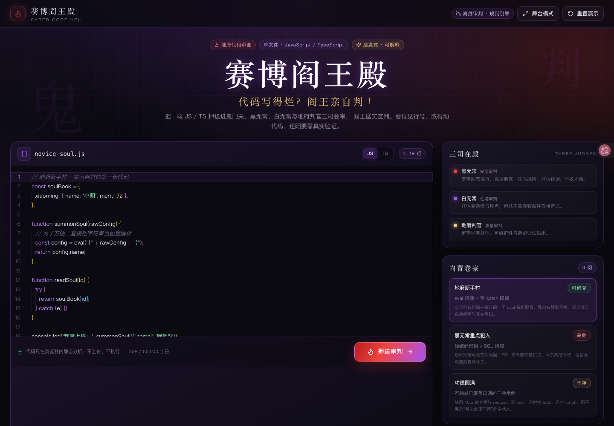
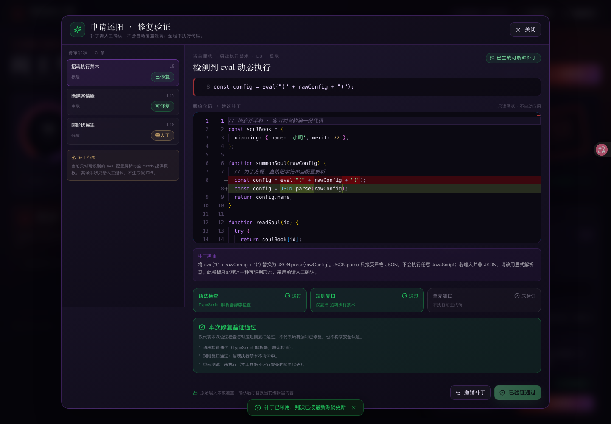

# 赛博阎王殿 · Cyber Code Hell

> 代码写得烂？阎王亲自判。

把一段 JavaScript / TypeScript 押送进赛博地府：黑无常审安全，白无常审性能，地府判官审质量，阎王根据**真实规则命中**汇总罪状；随后可以申请还阳，查看可解释的 Monaco Diff，确认采用后执行**真实静态语法检查与规则复扫**。



## 快速开始

要求 Node.js **20.19+**（开发时使用 Node 26.8.2）。安装依赖任选一种包管理器：

```bash
pnpm install
pnpm dev
# 或 npm install && npm run dev
```

打开终端提示的地址，默认 <http://localhost:5173>。

```bash
pnpm typecheck   # TypeScript 严格模式类型检查
pnpm test        # Vitest 规则引擎、补丁、验证测试
pnpm build       # 生产构建（tsc --noEmit && vite build）
pnpm preview     # 预览生产构建
```

Monaco Editor 使用本地打包的 `monaco-editor` 与 Web Worker，不依赖 CDN；**断网也能完整演示**。

## 三屏闭环

1. **鬼门关**：Monaco 代码编辑器、JS/TS 切换、3 个内置卷宗、字符上限与错误提示。
2. **三司会审**：三位判官逐一出场，显示真实命中数量与最重罪状，动画总时长约 1.7 秒。
3. **生死簿**：功德值、阎王判词、严重程度统计、按判官分组的罪状、行号与原始证据、修复建议。


## 已实现的规则（6 条，纯启发式）

| 规则 | 判官 | 默认严重度 | 置信度 | 自动补丁 |
| --- | --- | --- | --- | --- |
| `eval` 动态执行 | 黑无常 | 极危 | 疑似 | 仅识别 `eval("(" + var + ")")` → `JSON.parse(var)` |
| 疑似硬编码凭据 | 黑无常 | 高危 | 疑似 | 无（需人工迁移密钥） |
| SQL 字符串拼接 / 模板插值 | 黑无常 | 高危 | 疑似 | 无（需参数化查询上下文） |
| 空 catch | 地府判官 | 中危 | 结构确认 | 有（写入 `console.error` 记录异常） |
| 嵌套循环热点 | 白无常 | 低危 | 疑似 | 无（需基准测试） |
| 遗留 `console.log` | 地府判官 | 低危 | 结构确认 | 无 |

- 注释中的代码不触发；字符串内容对 `eval` 检测做遮罩，避免普通字符串误报。
- 仅写注释的 `catch` 视为有意忽略，不报空 catch。
- 命中统一称为“疑似问题”；`console.log` 只算低危，不当作高危漏洞。
- 证据直接取自源码对应行，行号从 1 开始，结果按严重度排序、去重并限制 60 条。

## 功德值与判词

初始 100 分，按真实命中扣分：极危 −25、高危 −15、中危 −7、低危 −3，最低 0。分数只是游戏化表达，**不是安全评分或认证**。判词由固定模板依据命中问题生成，不随机捏造问题；零命中时只显示“当前覆盖的规则中暂未发现你的问题”。

## 申请还阳：Diff、确认、验证、撤销



1. 选择罪状 → 生成补丁预览（Monaco Diff，只读）。
2. 必须手动点击“确认采用补丁”，不会自动覆盖原始输入。
3. 采用后执行：
   - **语法检查**：TypeScript 解析器静态检查（PASS / FAIL）。
   - **规则复扫**：仅复扫本次罪状对应的规则（PASS / FAIL）。
   - **单元测试**：永远显示 `未执行`，因为绝不运行用户提交的陌生代码。
4. 只有本次实际执行的语法检查与规则复扫均通过，才显示“**本次修复验证通过**”，并明确说明不代表所有漏洞已修复。
5. 支持“撤销补丁”，恢复采用前源码并重新审判。

无自动模板的罪状只给人工修复建议，**不生成假 Diff**。

## 隐私与安全边界

- 不执行任何提交的代码；验证只有 AST 解析 / 正则规则复扫。
- 不联网、不上传源码；Monaco 与全部资源本地打包。
- 不自动提交 PR、不写数据库、不需要 Docker 或微服务。
- 当前只支持 JS/TS **单文件**，上限 50,000 字符；其他语言显示暂不支持。
- 未实现云端 AI 代理（P1 可选扩展）。页眉常驻“离线审判”标识，无 AI Key 不影响演示。

## 测试与验证结果

2026-10-24 实际执行：

| 检查 | 命令 | 结果 |
| --- | --- | --- |
| 类型检查 | `tsc --noEmit` | **PASS** |
| 单元测试 | `vitest run` | **PASS**（3 个文件 / 39 个测试） |
| 生产构建 | `vite build` | **PASS** |
| 浏览器闭环 | 无头 Edge 实际操作 | **PASS**：审判 → 判决 → 还阳 → Diff → 确认 → 复扫通过 |
| AI 代理 | — | **NOT IMPLEMENTED**（可选 P1） |
| 前端泄露 AI Key | 构建产物检索 | **不适用**：前端无任何密钥或 AI 请求 |

完整清单见 [docs/verification.md](docs/verification.md)。3 分钟路演稿见 [docs/demo-script.md](docs/demo-script.md)。

## 目录结构

```text
src/
  domain/types.ts          # Issue / Judgment / Patch / VerificationResult
  engine/rules.ts          # 6 条纯函数启发式规则、注释/字符串预处理
  engine/score.ts          # 确定性功德分数
  engine/verdict.ts        # 三司汇总与阎王判词
  engine/patcher.ts        # 受控修复模板
  engine/verify.ts         # TypeScript 语法检查 + 规则复扫（不执行代码）
  data/demoCases.ts        # 3 个真实可扫描的内置案例
  data/judges.ts           # 判官视觉与职责元数据
  components/              # 鬼门关、三司会审、生死簿、Diff、还阳面板
  state/                   # 由 App 持有的轻量状态机（gate → judging → verdict）
.kiro/specs/cyber-code-hell/  # requirements / design / tasks
.kiro/steering/               # product / tech / quality
docs/                         # 路演稿、验证记录、截图
```

## 已知限制

- 规则是启发式：无法证明代码安全，也无法覆盖业务逻辑、依赖漏洞、类型错误。
- 嵌套循环检测依赖花括号与单行 `for/while (` 形态；其他写法可能漏报。
- 自动补丁只覆盖两个受控模板，不适用于任意代码。
- 没有多文件、GitHub 导入、分享卡片、团队协作和服务端持久化。
- 无 AI 三司会审；若后续接入，必须保持离线闭环、明确同意上传、Zod 校验、证据回验，并对 AI 内容标记“待核实”。

## 设计文档

- [需求规格](.kiro/specs/cyber-code-hell/requirements.md)
- [技术设计](.kiro/specs/cyber-code-hell/design.md)
- [任务拆解](.kiro/specs/cyber-code-hell/tasks.md)
- [产品 Steering](.kiro/steering/product.md) · [技术 Steering](.kiro/steering/tech.md) · [质量 Steering](.kiro/steering/quality.md)
